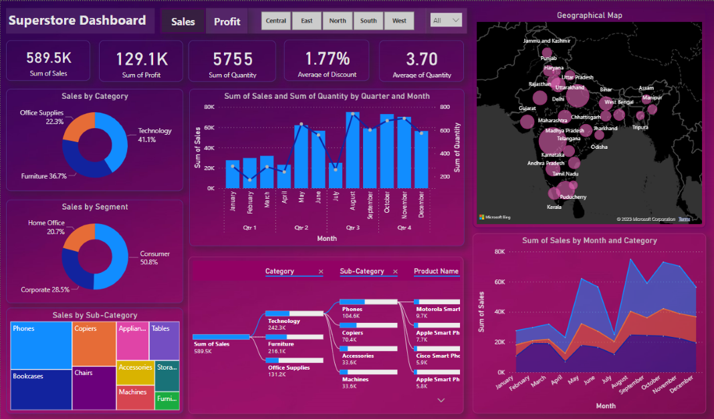

# 📊 Superstore Sales Analysis Dashboard | Power BI

An interactive **Power BI Dashboard** developed to analyze Superstore sales, profit, quantity, discounts, product categories, customer segments, and geographical performance.

This project was completed as part of the **Elevate Labs Data Analyst Internship — Task 2: Data Visualization and Storytelling**.

---

## 📸 Dashboard Preview



---

## 🎯 Project Objectives

- Analyze overall sales, profit, and quantity performance.
- Compare sales across product categories and customer segments.
- Understand monthly and quarterly sales trends.
- Explore geographical sales distribution across India.
- Identify product and sub-category contributions to overall sales.
- Present business insights through interactive visualizations.

---

## 📌 Key Performance Indicators (KPIs)

| KPI | Value |
|---|---:|
| Total Sales | 589.5K |
| Total Profit | 129.1K |
| Total Quantity | 5,755 |
| Average Discount | 1.77% |
| Average Quantity | 3.70 |

---

## 📈 Dashboard Features

### 1. Sales by Category
Doughnut chart displaying sales contribution from Technology, Furniture, and Office Supplies.

### 2. Sales by Customer Segment
Comparison of sales across Consumer, Corporate, and Home Office segments.

### 3. Sales by Sub-Category
Treemap visualizing the contribution of different product sub-categories.

### 4. Monthly & Quarterly Sales Trends
Combination chart comparing monthly sales and quantity across four quarters.

### 5. Geographical Sales Distribution
Map visualization displaying sales distribution across Indian states and regions.

### 6. Monthly Sales by Category
Stacked area chart comparing monthly sales contributions from different product categories.

### 7. Interactive Decomposition Tree
Drill-down analysis of sales by Category, Sub-Category, and Product Name.

### 8. Interactive Filters
Region filters and dashboard navigation controls for exploring business performance.

---

## 🛠️ Tools & Technologies

- **Power BI Desktop** – Dashboard development and visualization.
- **Power Query** – Data cleaning and transformation.
- **DAX** – Measures and KPI calculations.
- **Superstore Dataset** – Sales and business data.

---

## 📂 Repository Structure

```text
Superstore-Dashboard/
│
├── Superstore Dashboard.pbix
├── Superstore_Dashboard.png
└── README.md
```

---

## 🚀 How to Use

1. Clone or download this repository.
2. Install [Microsoft Power BI Desktop](https://www.microsoft.com/power-platform/products/power-bi/desktop).
3. Open `Superstore Dashboard.pbix`.
4. Explore the interactive charts, filters, map, and decomposition tree.

**Note:** If the original dataset is not included, reconnect the data source before refreshing the report.
